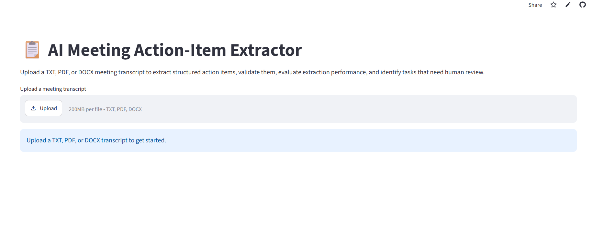
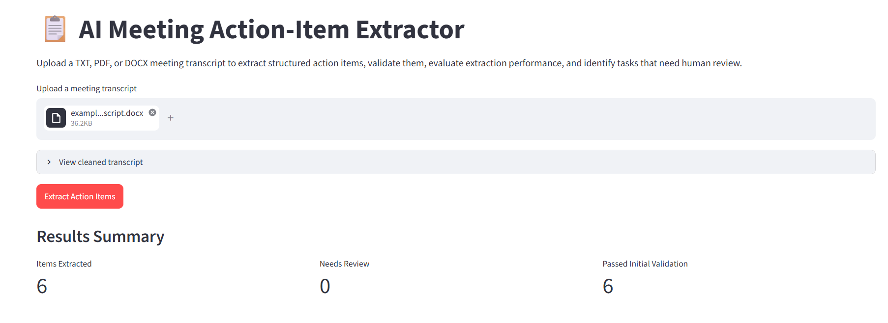
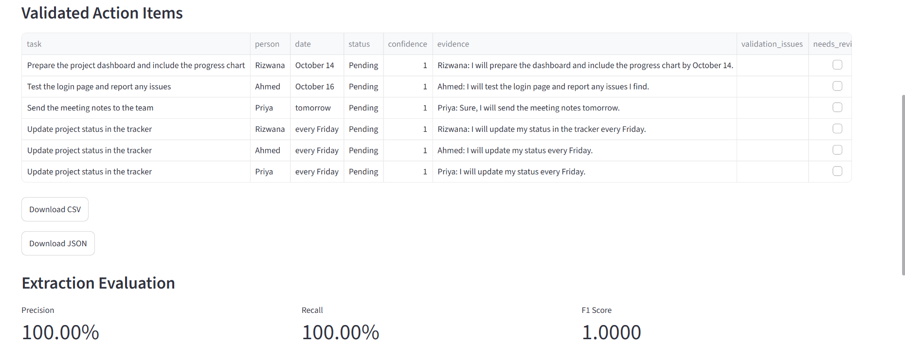
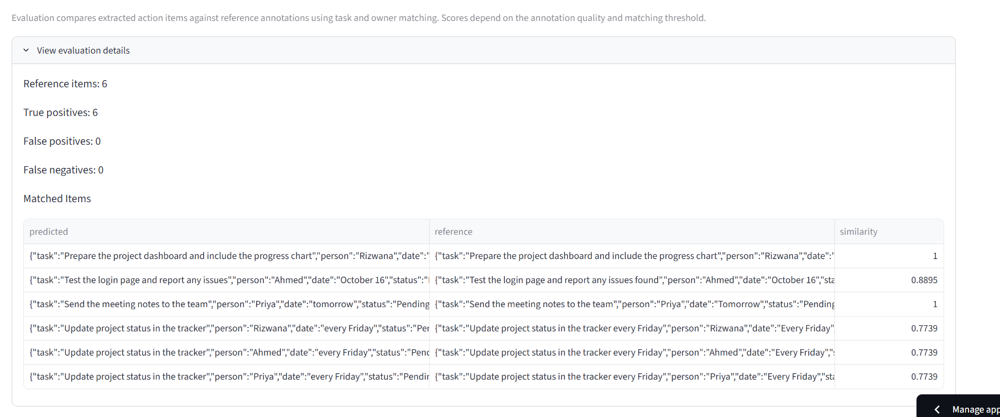

# 📋 AI Meeting Action-Item Extractor

An AI-powered web application that converts meeting transcripts into structured action items using Google's Gemini API.

🔗 **Live Demo:** [Try the application](https://ai-meeting-action-item-extractor-zuocqhxtbskckmptn299cx.streamlit.app/)

💻 **GitHub Repository:** [View Source Code](https://github.com/RizwanaSheik/AI-Meeting-Action-Item-Extractor)

## ✨ Features

- 📄 Upload meeting transcripts in TXT, PDF, and DOCX formats.
- 🤖 Extract action items using Google Gemini AI.
- 👤 Identify tasks, owners, deadlines, and status.
- ✅ Validate action items and flag issues for human review.
- 📊 Calculate Precision, Recall, and F1 Score using reference annotations.
- 📥 Download results as CSV and JSON files.
- 🔎 View supporting evidence and confidence scores.
- 🖥️ Interactive Streamlit dashboard.

## 🛠️ Technologies Used

Python · Streamlit · Google Gemini API · Pandas · Scikit-learn · pypdf · python-docx

## 📸 Screenshots

### 1. Application Dashboard


### 2. Extracted Action Items


### 3. Evaluation Metrics


### 4. Human Review Queue


## 🚀 Run Locally

**1. Clone the repository**

```bash
git clone https://github.com/RizwanaSheik/AI-Meeting-Action-Item-Extractor.git
cd AI-Meeting-Action-Item-Extractor
```

**2. Create and activate a virtual environment**

```powershell
python -m venv .venv
.venv\Scripts\Activate.ps1
```

**3. Install dependencies**

```powershell
python -m pip install -r requirements.txt
```

**4. Configure your Gemini API key**

Create a `.env` file in the project root:

```text
GEMINI_API_KEY=YOUR_GEMINI_API_KEY
```

Replace the placeholder with your own API key. Never upload your `.env` file to GitHub.

**5. Run the application**

```powershell
python -m streamlit run app.py
```

## 📊 Evaluation

The application compares extracted action items with reference annotations and calculates:

- **Precision:** How many predicted items correctly match the reference.
- **Recall:** How many reference items were successfully identified.
- **F1 Score:** A combined measure of precision and recall.

Evaluation requires a matching reference annotation JSON file. Scores depend on the quality of the annotations and the matching method.

## 🧪 Run Tests

```powershell
python -m tests.test_preprocessing
python -m tests.test_validation
python -m tests.test_evaluation
python -m tests.test_extraction
python -m tests.test_pipeline
```

The extraction and pipeline tests require Gemini API access.

## 🔐 Security

- Store API keys in `.env` locally or Streamlit Secrets in the cloud.
- Never commit API keys or confidential transcripts to GitHub.
- Review AI-generated action items before relying on them.

## 👩‍💻 Author

**Sheik Rizwana Begum**

Computer Science and Engineering (Data Science) Student

[GitHub Profile](https://github.com/RizwanaSheik)
